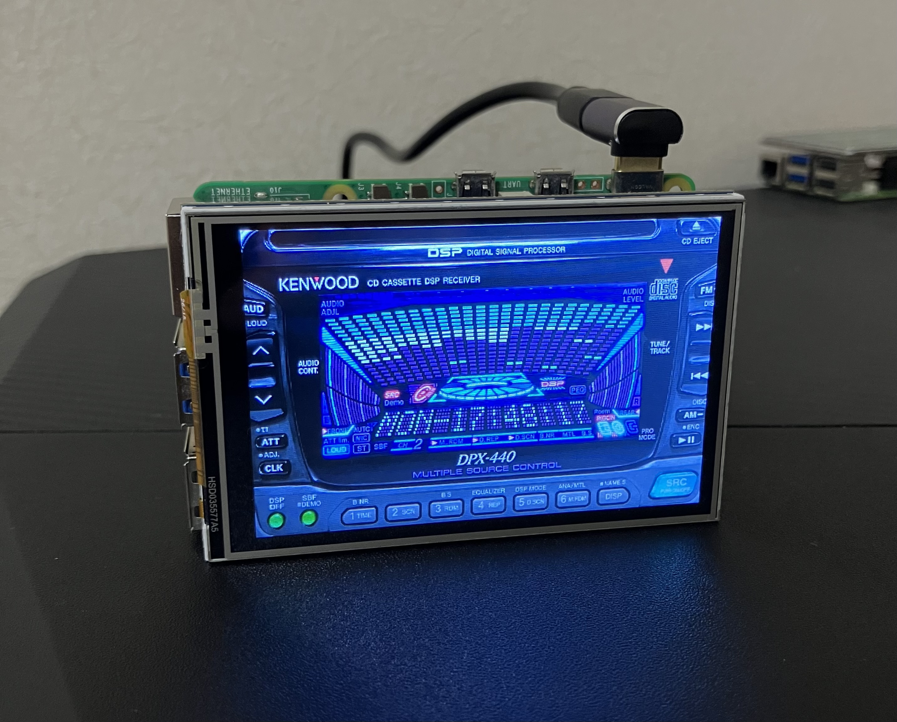
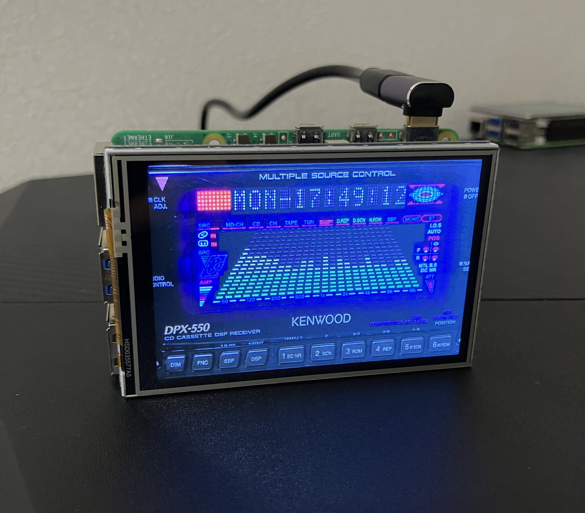
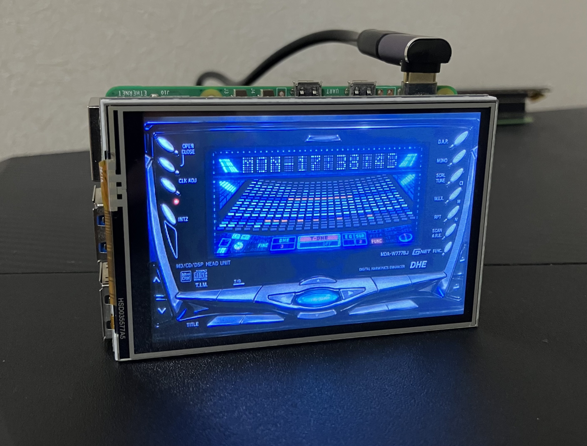

# Retro Car Stereo Display

Raspberry PiとPythonを使って、1990年代のカーオーディオの表示画面を再現するプロジェクトです。

当時のカーオーディオに特徴的な3Dスペクトラムアナライザーやドットマトリクス表示、レベルメーターなどを、PythonのPygameで再現しています。

KENWOODのDPX-440、DPX-550、ALPINEのMDA-W779BJの3機種に対応しています。

音声再生機能はありません。懐かしいカーオーディオの表示演出を楽しむための作品です。

## 対応機種

### KENWOOD DPX-440



- 立体的な3Dスペクトラムアナライザー
- 左右対称の曲線状サイドメーター
- 2列ずつ上から下に流れる点灯アニメーション
- 機種名、メーカー名、現在時刻を切り替えるドットマトリクス表示

### KENWOOD DPX-550



- 奥行きのある3Dスペクトラムアナライザー
- 24バンドのレベル変化アニメーション
- 曜日と現在時刻を表示するドットマトリクス

### ALPINE MDA-W779BJ



- 扇状に広がる3Dスペクトラムアナライザー
- 青系の18段カラー表示とアクセントカラー
- 中央から上下に広がるレベル変化アニメーション
- 曜日と現在時刻を表示するドットマトリクス

## 動作環境

以下の環境を想定しています。

| 項目 | 内容 |
|---|---|
| コンピューター | Raspberry Pi 5 |
| OS | Raspberry Pi OS（Trixie） |
| プログラミング言語 | Python |
| 描画ライブラリ | Pygame |
| 描画解像度 | 800×480 |
| 液晶モジュール | MHS35 SPI液晶（480×320） |
| 画面表示方式 | Wayland DMA-BUFミラーリング |

## 事前準備

MHS35 SPI液晶を使用する場合は、以下のミラーリングプログラムを設定してください。

**[Raspberry Pi SPI LCD Mirror](https://github.com/sozoraemon/raspberry-pi-spi-lcd-mirror)**

このプログラムを使用すると、Raspberry Piのデスクトップ画面をMHS35 SPI液晶にミラーリングできます。

インストールと動作確認は、リンク先のREADMEに従って完了させてください。

Pygameも必要です。インストールされていない場合は、次のコマンドで導入できます。

```bash
sudo apt update
sudo apt install python3-pygame
```

## 画面解像度の変更

本プロジェクトでは800×480のデスクトップ解像度を使用します。

MHS35 SPI液晶のミラーリング環境を設定済みの場合は、既存の自動起動設定にある解像度指定を書き換えます。

ターミナルで以下のコマンドを実行してください。

```bash
mkdir -p ~/.config/labwc && touch ~/.config/labwc/autostart && sed -i '/wlr-randr --output NOOP-1 --custom-mode/d' ~/.config/labwc/autostart && echo '( sleep 3; wlr-randr --output NOOP-1 --custom-mode 800x480 ) &' >> ~/.config/labwc/autostart
```

設定後、Raspberry Piを再起動してください。

```bash
sudo reboot
```

再起動後、ミラーリング環境の仮想ディスプレイ解像度が800×480に設定されます。

### SPI液晶への表示について

MHS35 SPI液晶の解像度は480×320です。

ミラーリングプログラムは800×480の画面全体を480×320に縮小するため、横方向に約10％圧縮された表示になります。

## プログラムの実行

本リポジトリを取得します。

```bash
git clone https://github.com/sozoraemon/retro-car-stereo-display.git
cd retro-car-stereo-display
```

使用する機種のPythonファイルを実行してください。

**KENWOOD DPX-440**

```bash
python3 dpx440.py
```

**KENWOOD DPX-550**

```bash
python3 dpx550.py
```

**JVC MDA-W779BJ**

```bash
python3 w779jb.py
```

実行すると、カーオーディオの表示アニメーションが始まります。

終了する場合は、Escキーを押してください。

### ファイル構成

すべてのPythonファイルと背景画像を、リポジトリの同じ階層に配置します。

```text
retro-car-stereo-display/
├── README.md
├── dpx440.py
├── dpx440.png
├── dpx550.py
├── dpx550.png
├── w779jb.py
└── w779jb.png
```

各Pythonファイルは、同じフォルダにある対応する背景画像を読み込みます。

## 表示アニメーションについて

### 3Dスペクトラムアナライザー

24バンドのスペクトラムアナライザーを描画します。

各バンドの高さをランダムに変化させ、音楽に合わせて動いているような演出を再現しています。

機種ごとに形状や配色、点灯パターンが異なります。

### 左右サイドメーター

DPX-440では、左右対称の曲線状メーターを表示します。

点灯位置を一定間隔で移動させ、光が流れるような動きを表現しています。

曲線は高解像度で描画してから縮小し、輪郭を滑らかにしています。

### ドットマトリクス

5×7ドットの文字を使用し、曜日や現在時刻などを表示します。

DPX-440では、メーカー名と機種名も順番に表示し、文字の切り替えアニメーションを加えています。

## 注意事項

- Raspberry Pi 5とMHS35 SPI液晶を想定していますが、Pygameが動作するほかの環境でも利用できる場合があります。
- 表示アニメーションは実際の音声信号とは連動していません。
- 20FPS・30FPSは各プログラムの設定値です。実際の描画速度は動作環境によって異なります。
- SPI液晶へのミラーリング速度は、Pythonプログラムの描画速度とは異なります。
- 掲載するメーカー名や商標は、それぞれの権利者に帰属します。
- 本プロジェクトは各カーオーディオメーカーの公式製品ではなく、各社による承認・提携を示すものではありません。
- 背景画像や製品デザインの権利については、公開・再利用の条件を別途確認してください。

## 関連プロジェクト

[Raspberry Pi SPI LCD Mirror](https://github.com/sozoraemon/raspberry-pi-spi-lcd-mirror)

Raspberry Pi 5のデスクトップをMHS35 SPI液晶にミラーリングするためのプログラムです。
