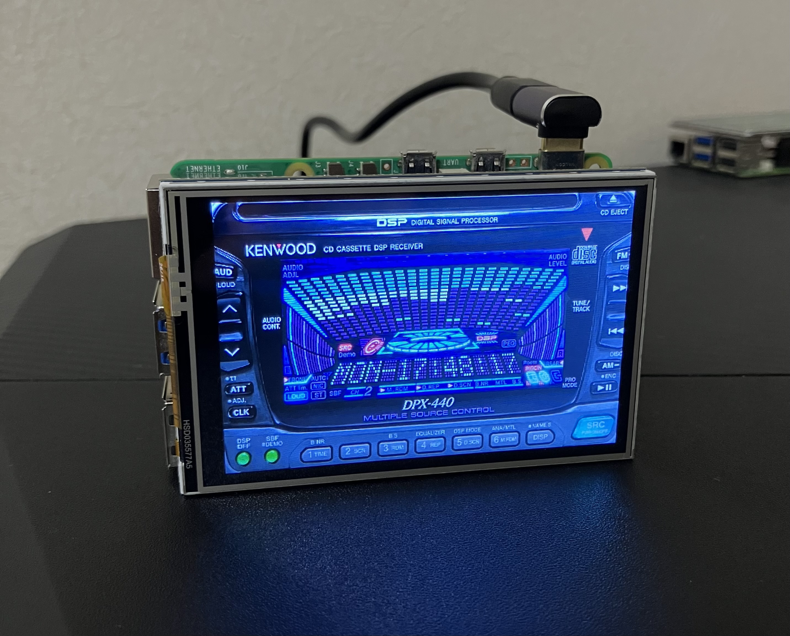
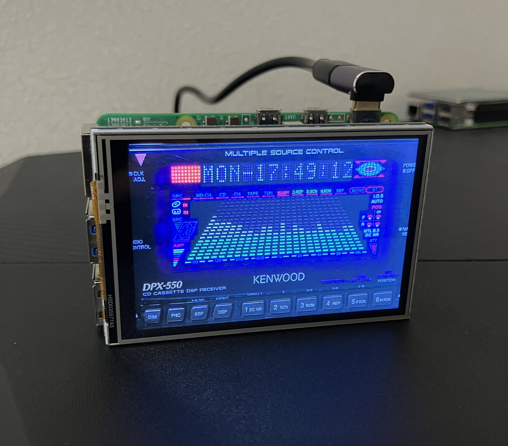
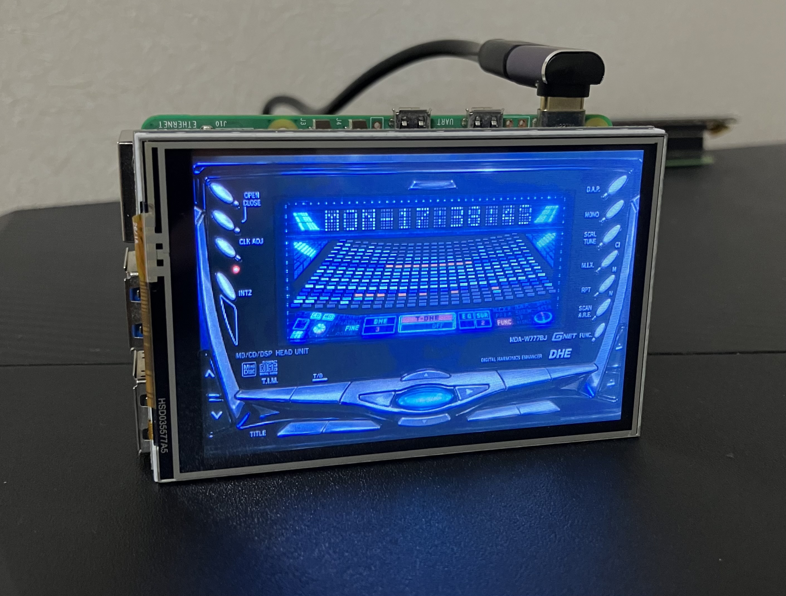
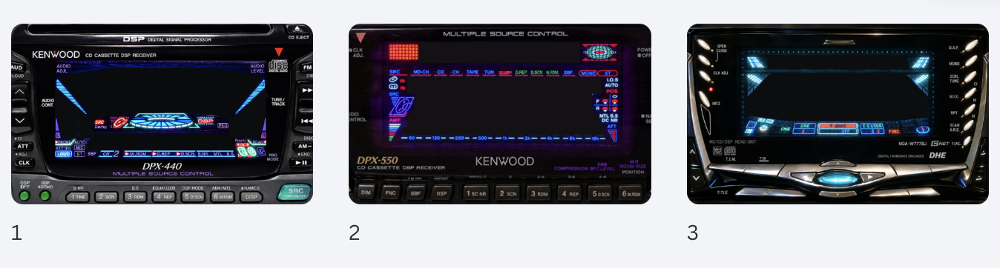

# Retro Car Stereo Display

A Raspberry Pi and Python project that recreates the display panels of Japanese car stereos from the 1990s.

Designed primarily for the [MHS35 SPI LCD (3.5-inch display for Raspberry Pi)](https://electronicwork.shop/items/6ac8ff42c5f8f197e65e1657), but also works with the [HyperPixel 4.0](https://shop.pimoroni.com/en-jp/products/hyperpixel-4?variant=12569485443155).

Using Python and Pygame, this project recreates the distinctive 3D spectrum analyzers, dot-matrix displays, and level meters found in car stereos of that era.

The three models featured are the KENWOOD DPX-440, KENWOOD DPX-550, and ALPINE MDA-W779JB.

There is no audio playback functionality. The spectrum analyzers animate randomly rather than responding to actual audio signals. This project is intended simply for enjoying the nostalgic visual effects of classic car stereos.

## Featured Models

### KENWOOD DPX-440



- Three-dimensional 3D spectrum analyzer
- Lighting animation that moves downward in pairs of columns
- Symmetrical curved side meters
- Dot-matrix display that cycles through the model name, manufacturer name, and current time

### KENWOOD DPX-550



- 3D spectrum analyzer with a sense of depth
- Dot-matrix display showing the day of the week and current time

### ALPINE MDA-W779JB



- Fan-shaped 3D spectrum analyzer with 18 levels of colored segments
- Dot-matrix display showing the day of the week and current time

## System Requirements

The project is designed for the following environment.

| Item | Specification |
|---|---|
| Computer | Raspberry Pi 5 |
| OS | Raspberry Pi OS (Trixie) |
| Programming language | Python |
| Graphics library | Pygame |
| Rendering resolution | 800×480 |
| Display | MHS35 SPI LCD (480×320), HyperPixel 4.0 (800×480) |
| Display method | Wayland DMA-BUF mirroring (for MHS35 SPI LCD) |

The MHS35 SPI LCD is the primary display used for this project, although the HyperPixel 4.0 is also supported.

You can find more information about the displays here:

- [MHS35 SPI LCD (3.5-inch Raspberry Pi display module)](https://electronicwork.shop/items/6ac8ff42c5f8f197e65e1657)
- [HyperPixel 4.0 — Pimoroni](https://shop.pimoroni.com/en-jp/products/hyperpixel-4?variant=12569485443155)

## Setup

If you are using the MHS35 SPI LCD, set up the following screen mirroring software:

**[Raspberry Pi SPI LCD Mirror](https://github.com/sozoraemon/raspberry-pi-spi-lcd-mirror)**

This software mirrors the Raspberry Pi desktop onto the MHS35 SPI LCD.

For more information about installing the display module and configuring the software, see my [blog article](https://sozorablog.com/raspberry-pi-3-5-inch-spi-lcd/) (in Japanese).

### Changing the Screen Resolution

This project uses a desktop resolution of 800×480.

If you have already configured the MHS35 SPI LCD mirroring environment, update the resolution setting in the existing autostart configuration.

Run the following command in a terminal:

```bash
mkdir -p ~/.config/labwc && touch ~/.config/labwc/autostart && sed -i '/wlr-randr --output NOOP-1 --custom-mode/d' ~/.config/labwc/autostart && echo '( sleep 3; wlr-randr --output NOOP-1 --custom-mode 800x480 ) &' >> ~/.config/labwc/autostart
```

Restart your Raspberry Pi after applying the change:

```bash
sudo reboot
```

After restarting, the virtual display used for mirroring will be configured to 800×480.

## Running the Program

Clone this repository:

```bash
git clone https://github.com/sozoraemon/retro-car-stereo-display.git
cd retro-car-stereo-display
```

Run the Python script for the model you want to display.

**KENWOOD DPX-440**

```bash
python3 dpx440.py
```

**KENWOOD DPX-550**

```bash
python3 dpx550.py
```

**ALPINE MDA-W779JB**

```bash
python3 w779jb.py
```

The car stereo display animation will start. Press the Esc key to exit.

### Running via SSH

When running the program over SSH, the Wayland display environment may not be configured automatically, preventing the animation from appearing on the screen.

In that case, specify the environment variables explicitly:

```bash
XDG_RUNTIME_DIR="/run/user/$(id -u)" \
WAYLAND_DISPLAY=wayland-0 \
SDL_VIDEODRIVER=wayland \
python3 dpx440.py
```

To run another model, replace `dpx440.py` with the corresponding Python filename.

This example assumes that the Wayland socket is named `wayland-0`. If your environment uses a different socket name, adjust the value accordingly.

Press Esc to exit. When running via SSH, you can also stop the program by pressing Ctrl+C in the terminal.

### File Structure

The repository has the following structure:

```text
retro-car-stereo-display/
├── README.md
├── dpx440.py
├── dpx440.png
├── dpx550.py
├── dpx550.png
├── w779jb.py
├── w779jb.png
└── photos/
    ├── dpx440.jpeg
    ├── dpx550.jpeg
    └── w779jb.jpeg
```

Each Python script loads its corresponding background image from the same directory.

## How the Display Animations Work

Each car stereo model uses a static background image that recreates its original appearance. Python and Pygame draw the animations on top of that image.



The background remains stationary while the spectrum analyzer, dot-matrix display, and level meters are animated.

### 3D Spectrum Analyzer

The program draws a 24-band spectrum analyzer.

The height of each band changes randomly, creating the appearance of movement synchronized with music.

Each model has its own shape, colors, and lighting patterns.

### Side Meters

The DPX-440 features symmetrical curved side meters.

The illuminated positions move at regular intervals to create a flowing light effect.

The curves are rendered at a higher resolution and then scaled down to produce smoother edges.

### Dot-Matrix Display

A 5×7 dot-matrix font is used to display information such as the day of the week and current time.

On the DPX-440, the display also cycles through the manufacturer name and model name, with animated text transitions.

## Notes

- This project is primarily designed for Raspberry Pi 5 with the MHS35 SPI LCD, but it may also work in other environments that support Pygame.
- The display animations are not synchronized with actual audio signals.
- The SPI LCD mirroring refresh rate is different from the Python program's rendering frame rate.
- All manufacturer names and trademarks belong to their respective owners.
- This is an independent project and is not an official product of, endorsed by, or affiliated with any of the car stereo manufacturers.
- Please verify the applicable rights and usage conditions before publishing or reusing the background images or product designs.

## Related Project

[Raspberry Pi SPI LCD Mirror](https://github.com/sozoraemon/raspberry-pi-spi-lcd-mirror)

Software for mirroring the Raspberry Pi 5 desktop onto an MHS35 SPI LCD.
